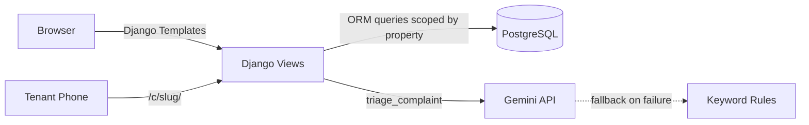

# 🏠 PGDesk — Modern PG Management for India

> **Run your PG without the notebook.**  
> Track rent, send WhatsApp reminders in one tap, and let AI handle complaint triage.

---

## 🎯 Problem

Small PG/hostel owners in India (10-60 beds) run everything on notebooks and WhatsApp:
- Rent payments get missed or forgotten
- Complaints are lost in chat threads  
- Nobody knows who owes what at a glance

## 💡 Solution

PGDesk is a simple, mobile-first web app that gives PG owners:
1. **Rent Dashboard** — See who's paid, who's due, who's overdue at a glance
2. **One-Tap WhatsApp Reminders** — Pre-filled polite messages with tenant details
3. **AI Complaint Triage** — Tenants submit via a public link; AI categorises, prioritises, and drafts replies

## ✨ Features

| Feature | Description |
|---------|-------------|
| 📊 Dashboard | 4 stat cards + tenant table with colour-coded status badges |
| 💰 Rent Tracking | Mark payments in one click, filter by Paid/Due/Overdue |
| 💬 WhatsApp Reminders | One-tap link opens WhatsApp with a polite pre-filled message |
| 🤖 AI Complaint Triage | Gemini API categorises complaints, assigns urgency, drafts owner replies |
| 🔗 Public Complaint Link | Tenants submit complaints without logging in (mobile-first form) |
| 🏠 Room Management | Add rooms, add tenants, deactivate tenants |
| 📊 Weekly Summary | AI-powered weekly overview of rent status and complaints |

## 🏗️ Architecture



**Key design decisions:**
- Server-rendered Django templates — no SPA complexity
- Multi-tenant by property: every query is scoped to the logged-in owner's property
- AI triage is isolated in `core/ai.py` (one function) for easy swap to async queue
- Keyword fallback ensures the demo never fails, even without a Gemini API key

## 🛠️ Stack

| Layer | Tech |
|-------|------|
| Backend | Python 3.11+, Django 5.x |
| Frontend | Django Templates + Tailwind CSS (CDN) |
| Database | PostgreSQL (prod) / SQLite (dev) |
| AI | Gemini API (google-genai SDK) with keyword fallback |
| Server | Gunicorn + WhiteNoise |
| Deploy | Render (web service + managed Postgres) |

## 🚀 Local Setup

```bash
# 1. Clone and enter project
git clone <repo-url> && cd pgdesk

# 2. Create virtual env
python -m venv venv
source venv/bin/activate  # Windows: venv\Scripts\activate

# 3. Install dependencies
pip install -r requirements.txt

# 4. Set up environment (optional — app works without Gemini key)
cp .env.example .env
# Edit .env and add your GEMINI_API_KEY if you have one

# 5. Run migrations
python manage.py migrate

# 6. Seed demo data
python manage.py seed_demo

# 7. Start server
python manage.py runserver
```

Visit http://127.0.0.1:8000 — click "Try Demo" or log in with `demo` / `demo12345`

## 🔑 Environment Variables

| Variable | Required | Description |
|----------|----------|-------------|
| `SECRET_KEY` | Prod only | Django secret key |
| `DEBUG` | No | `True` for dev (default), `False` for prod |
| `ALLOWED_HOSTS` | Prod only | Comma-separated hostnames |
| `CSRF_TRUSTED_ORIGINS` | Prod only | Full URLs (e.g. `https://app.onrender.com`) |
| `DATABASE_URL` | Prod only | PostgreSQL connection string |
| `GEMINI_API_KEY` | No | Gemini API key for AI triage (falls back to keywords) |

## ☁️ Deploy to Render

1. Push code to GitHub
2. On Render, click "New → Blueprint" and connect your repo
3. Render reads `render.yaml` and creates the web service + Postgres
4. Add `GEMINI_API_KEY` in Render's environment variables (optional)
5. Deploy! The build script runs migrations and seeds demo data automatically

**Or manually:**
- Web Service: Python, build command `./build.sh`, start command `gunicorn pgdesk.wsgi:application`
- Postgres: Add a Render Postgres instance and set `DATABASE_URL`

## 🎬 Demo Credentials

| | |
|---|---|
| **URL** | `/` (landing) or `/dashboard/` |
| **Username** | `demo` |
| **Password** | `demo12345` |
| **Complaint link** | `/c/sunrise-pg/` |

## 📈 Scalability Notes

- **Multi-tenant isolation**: Every DB query is scoped by `property` (FK to owner)
- **DB indexes**: On `Tenant(property, is_active)`, `RentPayment(tenant, month)`, `Complaint(property, status, urgency)`
- **N+1 prevention**: Dashboard uses `select_related("room")` on tenant queries
- **AI isolation**: `triage_complaint()` is a single function — can be moved to a Celery/Redis async task queue with zero view changes
- **Cached dashboard**: Stats queries can be cached (Redis) with per-property keys as traffic grows
- **Horizontal scaling**: Stateless Django app behind Gunicorn — add workers/instances as needed

## 💰 Business Model

| Plan | Price | Beds | Target |
|------|-------|------|--------|
| Starter | ₹299/mo | Up to 15 | Single PG owners |
| Growth | ₹599/mo | Up to 40 | Growing operators |
| Pro | ₹999/mo | Up to 100 | Multi-property managers |

**Unit economics:**
- Server cost per customer: ~₹30-50/mo (Render, shared infra)
- Gemini API cost: ~₹5-15/mo per property (~50 complaints/month)
- Gross margin: 85-90% at scale

**Target market:** India has 1M+ PG/hostel operators. Even 0.1% penetration = 1,000 paying customers = ₹3-10L MRR.

## 📄 License

Built for a hackathon. MIT License.
